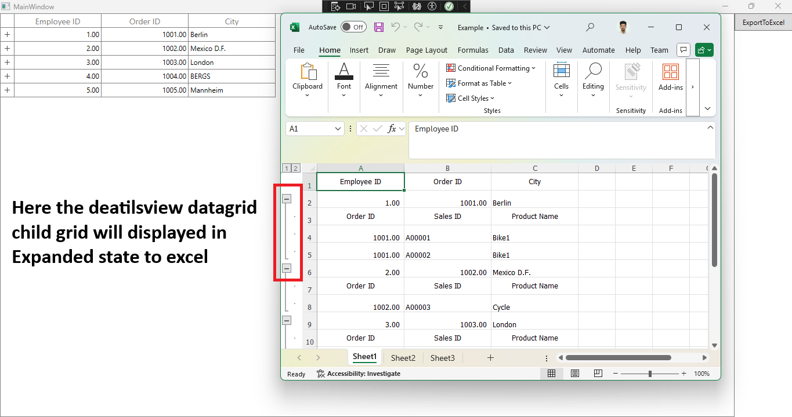

# How to export DetailsView records in expanded state from WPF DataGrid?

In [WPF DataGrid](https://www.syncfusion.com/wpf-controls/datagrid) (SfDataGrid) , you can export DataGrid to excel and it is possible to process the exported excel file using XlsIO. For example, you can expand the details view records in exported excel file alone by calling **Range.ExpandGroup** method for worksheet.

```C#
ExcelExportingOptions exportoption = new ExcelExportingOptions();
var excelengine = datagrid.ExportToExcel(datagrid.View, exportoption);
var workbook = excelengine.Excel.Workbooks[0];
workbook.Worksheets[0].Range.ExpandGroup(ExcelGroupBy.ByRows, ExpandCollapseFlags.IncludeSubgroups);
```

In the below screen shot, DetailsViewDataGrid expanded only in excel file and not in DataGrid.



Take a moment to peruse the [WPF DataGrid - Exporting](https://help.syncfusion.com/wpf/datagrid/export-to-excel) documentation, to learn more about exporting with examples.

## Requirements to run the demo
- Visual Studio 2015 and above versions
- .NET Framework 4.5 or later
- Syncfusion WPF Suite
- XlsIO library
- Windows 7 or later
- Excel 2010 or later (optional, for viewing exported files)

## Support and Resources

For more information on Syncfusion SfDataGrid, visit [Syncfusion Documentation](https://help.syncfusion.com/wpf/datagrid/overview).